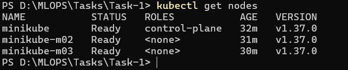
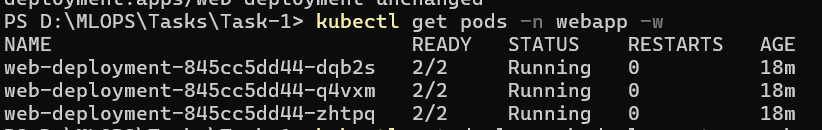
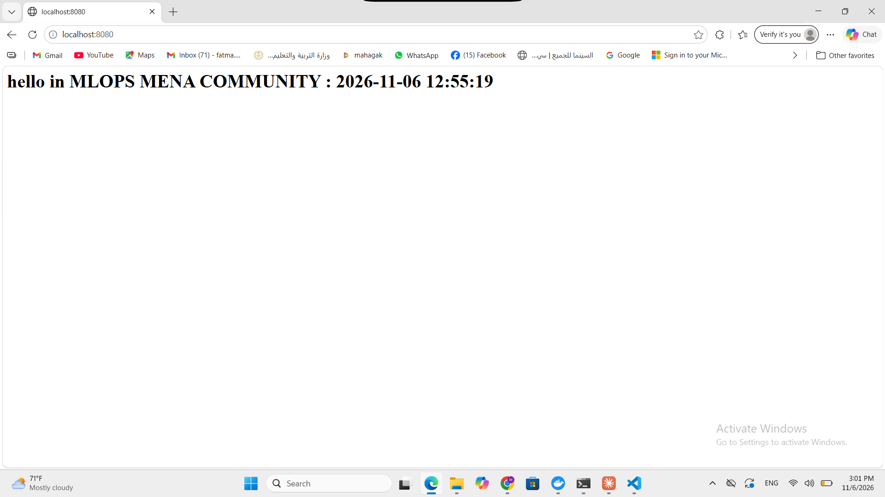
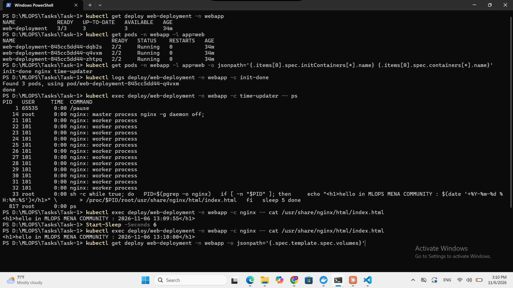
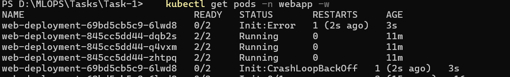
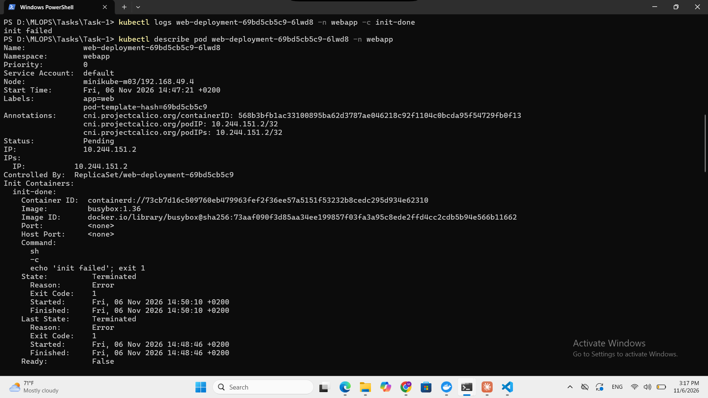
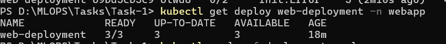

# Task 1: Multi-container Pods (Init Container & Sidecar)

A 3-replica nginx Deployment on a 3-node minikube cluster (Calico CNI). Each Pod has three containers and **no volume**:

| Container | Type | Job |
|-----------|------|-----|
| `init-done` | Init container | Prints `done` and exits. The other containers start only if it succeeds. |
| `nginx` | Main container | Writes `index.html` with the current time, then serves it on port 80 |
| `time-updater` | Sidecar | Rewrites `index.html` with the new time every 5 seconds |

The Pod uses `shareProcessNamespace: true`, so the sidecar sees the nginx process and writes into its filesystem through `/proc/<nginx-pid>/root` (this needs the `SYS_PTRACE` capability).

## Files

- `namespace.yaml`: namespace `webapp`
- `deployment.yaml`: `web-deployment` (3 replicas, label `app: web`, init container + nginx + sidecar, no volumes)
- `screenshots/`: proof of every step

## Step 1: Create the cluster

```bash
minikube start --driver=docker --nodes 3 --cni=calico --cpus 2 --memory 2200
kubectl get nodes
```

Result: 3 nodes (`minikube`, `minikube-m02`, `minikube-m03`) are `Ready`.



## Step 2: Create the namespace

```bash
kubectl apply -f namespace.yaml
kubectl get ns
```

## Step 3 and 4: Deploy and check

```bash
kubectl apply -f deployment.yaml
kubectl get pods -n webapp -w
```

Result: all 3 Pods reach `2/2 Running` (the init container finished, so only `nginx` and `time-updater` count in READY).



Open the page through a port-forward:

```bash
kubectl port-forward -n webapp deploy/web-deployment 8080:80
```

Open <http://localhost:8080>. After refreshing 5 seconds later, the time changes.

First load:



After refresh:


## Verification

```bash
kubectl get deploy web-deployment -n webapp
kubectl get pods -n webapp -l app=web
kubectl get pods -n webapp -l app=web -o jsonpath='{.items[0].spec.initContainers[*].name} {.items[0].spec.containers[*].name}'
kubectl logs deploy/web-deployment -n webapp -c init-done
kubectl exec deploy/web-deployment -n webapp -c time-updater -- ps
kubectl exec deploy/web-deployment -n webapp -c nginx -- cat /usr/share/nginx/html/index.html   # run twice, 5 s apart
kubectl get deploy web-deployment -n webapp -o jsonpath='{.spec.template.spec.volumes}'
```

| Check | Result |
|-------|--------|
| Deployment ready | READY `3/3` |
| Pods | 3 Pods, each `2/2 Running` |
| Containers | `init-done nginx time-updater` |
| Init succeeded | logs show `done` |
| Sidecar sees nginx | `nginx: master process` appears in the sidecar's `ps` |
| Time updates | two reads, 5+ seconds apart, show different times |
| No volumes | empty output |



> The time comes from the `date` command inside the containers. Containers use the UTC clock of the Docker Desktop Linux VM, so the shown time may differ from the local Cairo time.

## Step 5: Make the init container fail

Only the init container command was changed, to exit with code 1:

```yaml
command: ["sh", "-c", "echo 'init failed'; exit 1"]
```

```bash
kubectl apply -f deployment.yaml
kubectl get pods -n webapp -l app=web
kubectl logs <new-pod> -n webapp -c init-done
kubectl describe pod <new-pod> -n webapp
```

The new Pod goes `Init:Error` then `Init:CrashLoopBackOff` with READY `0/2`, while the 3 old Pods stay `2/2 Running`:



The init logs show `init failed`, and `describe` shows `Exit Code: 1` for `init-done`:



### Answers

- **Which status does the new Pod show?** `Init:Error`, then `Init:CrashLoopBackOff` (READY `0/2`). Kubernetes keeps restarting the init container with a growing back-off delay.
- **Do `nginx` and `time-updater` start?** No. Containers start only after every init container succeeds, and this one never does.
- **Is the page still reachable, and why?** Yes. The Deployment does a rolling update: it removes an old Pod only after a new Pod is Ready. The new Pod never becomes Ready, so the 3 old Pods keep running and serving the page.

## Step 6: Fix it

The init command was restored to `["sh", "-c", "echo done"]` and applied again (`kubectl apply -f deployment.yaml`). Instead, `kubectl rollout undo deploy/web-deployment -n webapp` also works.

```bash
kubectl get deploy web-deployment -n webapp
```

Result: READY `3/3`, UP-TO-DATE `3`.


